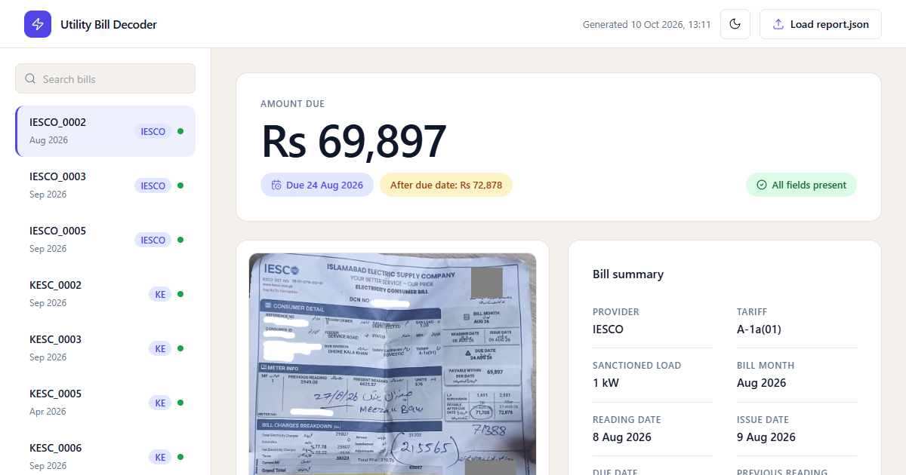

# Utility Bill Decoder



An intelligent parser and interactive results viewer for Pakistani electricity bills (K-Electric, LESCO, IESCO). Extracts meter readings, billing amounts, charges, taxes, and provides grounded AI question-answering over utility bills.

---

## ⚡ Features

- **Multi-Provider Support**: Seamlessly decodes bills from K-Electric, LESCO, and IESCO.
- **Deep Extraction (Level 1)**: Extracts 18 structured billing attributes including tariff, sanctioned load, billing month, reading dates, units consumed, detailed charges breakdown, and payable amounts.
- **Visual Question Answering (Level 2)**: Answers domain-specific queries (e.g. net-metering / solar connection verification, peak consumption months).
- **Fast Interactive Viewer**: Front-end results viewer with dark/light themes, instant search/filtering, high-resolution bill zoom modal, and offline support.
- **Open Graph Social Cards**: Rich social previews with 1200x630 branded card metadata configured for LinkedIn, X (Twitter), and Discord.

---

## 📁 Project Structure

```
├── app/
│   └── layout.tsx             # Next.js root layout with Open Graph metadata
├── frontend/
│   ├── app/
│   │   ├── layout.tsx         # Next.js metadata specification
│   │   └── opengraph-image.png# 1200x630 OG image asset
│   └── public/
│       └── og-image.png       # Static Open Graph social card
├── public/
│   └── og-image.png           # Public root Open Graph image (1200x630)
├── src/                       # Extraction and validation pipeline
├── utility-bill-decoder/
│   └── bill-decoder/          # Vite + React interactive results viewer
│       ├── index.html         # Head tags with OG & Twitter Card metadata
│       └── public/
│           ├── og-image.png   # 1200x630 social card
│           └── data/          # Report JSON and bill images
```

---

## 🚀 Getting Started

### 1. Web Viewer (Frontend)

```bash
cd utility-bill-decoder/bill-decoder
npm install
npm run dev      # Launch local dev server
npm run build    # Build production static bundle
npm run preview  # Test production build locally
```

### 2. Python Extraction Pipeline

```bash
# Set up environment variables (.env)
cp .env.example .env

# Install dependencies
pip install -r requirements.txt

# Run extraction & generate report
python src/main.py
python report_export.py --bills test/bills
```

---

## 🌐 Social Preview & Open Graph Configuration

The repository includes social preview card metadata in:
- `utility-bill-decoder/bill-decoder/index.html` (Vite SPA)
- `frontend/app/layout.tsx` (Next.js layout)
- Assets: `og-image.png` (1200x630) in `public/` and `utility-bill-decoder/bill-decoder/public/`

> **Note on Social Caching**: Social platforms (especially LinkedIn) aggressively cache metadata for up to 7 days. After deploying, run the URL through the [LinkedIn Post Inspector](https://www.linkedin.com/post-inspector/) or append `?v=1` to the shared URL to flush the cache.